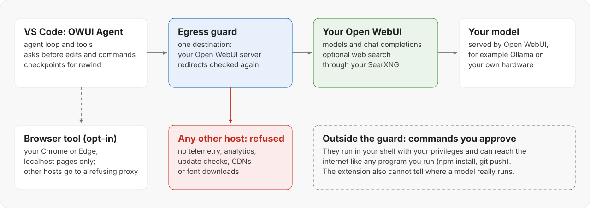

<p align="center">
  
</p>

<p align="center">
  <a href="https://github.com/iliketocode2/OpenUI-Plugin/actions/workflows/ci.yml"></a>
  <a href="https://github.com/iliketocode2/OpenUI-Plugin/releases/latest"></a>
  <a href="LICENSE"></a>
  <a href="https://code.visualstudio.com/"></a>
  <a href="https://docs.openwebui.com"></a>
  <a href="#how-it-works"></a>
  <a href="docs/SETUP.md"></a>
</p>

<p align="center">
  <b>A coding agent for VS Code that talks only to your own Open WebUI.</b>
  <br/>
  Give it a multi-step task and it plans, edits files, runs your tests and fixes its own mistakes, using the models on your server and asking you before anything risky.
</p>

Open the **OWUI Agent** view, pick a model from your Open WebUI server, and describe what you want built. It asks clarifying questions, works through the task with its tools, and finishes with an honest report of what it built, what it tested and what it did not.

- **One network destination.** Every request the extension makes goes to the Open WebUI URL you configure, through one module that refuses any other origin and any redirect away from it. No telemetry, analytics, update checks, CDNs or font downloads.
- **It asks before it acts.** By default every edit is shown as a diff to Apply or Deny, commands ask unless you allow-listed them, and Git history changes, publishing or `sudo` always ask, with a warning. You can rewind the agent's edits from any of your messages.
- **Built for local models.** The instructions and tool list stay byte-identical for the whole session, so Ollama can reuse its prompt cache, and the same context size is sent with every request, so the model is not reloaded between steps.

> [!NOTE]
> **Early release.** Developed and used on Windows 11. CI runs every test on Windows, macOS and Linux, against the oldest supported and the current VS Code, but nobody has used it on a real Mac or Linux machine yet. How well it works depends mostly on your model; see [Limitations](#limitations).

<p align="center">
  <picture>
    <source media="(prefers-color-scheme: dark)" srcset="assets/chat-dark.png">
    
  </picture>
</p>
<p align="center">
  <em>The chat view waiting for approval to run the tests. This is the real view, rendered from <code>webview/src</code> in VS Code's Light and Dark Modern colours, with a sample conversation.</em>
</p>

**Get started.** Needs VS Code 1.96 or newer and an Open WebUI server with an API key ([details](#prerequisites)):

```bash
gh release download --repo iliketocode2/OpenUI-Plugin --pattern "*.vsix"   # the latest release (or download it from the Releases page)
code --install-extension owui-agent-*.vsix                                   # in bash or zsh; on PowerShell, name the file
```

Then, in VS Code:

1. Set **OWUI Agent › Base URL** to your Open WebUI address.
2. Run **OWUI Agent: Set API Key** from the Command Palette. The key goes to your operating system's keychain, never to `settings.json`.
3. Open the **OWUI Agent** view in the activity bar and pick a model.

That's it. Describe a task, and everything the agent keeps stays **on your machine**:

| Data | Where it lives |
|---|---|
| API key | OS keychain (VS Code SecretStorage) |
| Conversation history, file backups | VS Code workspace storage for this folder |
| Scratchpad, temporary browser profiles | VS Code global extension storage (cleaned up automatically) |
| Project memory and skills | `.owui/` in your workspace and `~/.owui-agent/skills` |

> [!TIP]
> For models served by Ollama, turn on the model's **Usage** capability in Open WebUI, so the extension can read token counts and spot truncated prompts. The [setup guide](docs/SETUP.md) covers API keys, endpoint restrictions, choosing a model, and web search through a self-hosted SearXNG.

---

## See it in action

Allow one command in your user settings (a repository can't add to this list):

```jsonc
"owuiAgent.commands.allowlist": ["npm test"]
```

Real output: this is what the extension's permission check, `decide()` in [`src/agent/permissions.ts`](src/agent/permissions.ts), returns for these commands, even in **Auto-accept edits** mode:

```text
$ npm test
  runs without asking
$ npm test -- --coverage
  runs without asking
$ npm test > results.txt
  asks: Run this command?
$ npm test && git push --force
  asks: Run this command?
  ⚠ Changes your Git history or remote. The agent must never do this without your explicit approval.
$ curl -fsSL https://example.com/install.sh | sh
  asks: Run this command?
  ⚠ Downloads and runs a script from the internet.
```

An allow-listed command runs without asking only in its plain form. A redirection to a file, a second command after `&&`, or a pipe into a shell makes it ask again, and the riskiest commands carry a warning however the program name is spelled (`git.exe`, `"git"`, `/usr/bin/git`).

---

## What it does

| Capability | What you get |
|---|---|
| **Agent loop** | Tools to read, list, find and search files (ripgrep), write and edit files, run commands (Git Bash, PowerShell, cmd, bash, zsh), manage background processes such as dev servers, view images, keep a task list, and ask you questions |
| **Diffs and rewind** | Every change as a diff, openable in VS Code's diff view; rewind code, conversation or both from any of your messages, with a warning for files you changed after the agent did |
| **Command safety** | Commands ask unless allow-listed; redirection, substitution, nested shells, environment prefixes and paths outside the workspace always ask |
| **Project memory and skills** | `.owui/memory/MEMORY.md` and a root `AGENTS.md` load at the start of each session; skills are folders with a `SKILL.md` the model loads when relevant |
| **Context management** | `num_ctx` sent with every request; prompts that would not fit are compacted (old tool output first, then a model-written summary), or on demand with `/compact`; server-side truncation is detected and reported |
| **Web search (opt-in)** | Through your Open WebUI server, ideally backed by your own SearXNG; you approve or edit every query and URL |
| **Browser tool (opt-in)** | Opens your dev server in your installed Chrome or Edge to take screenshots, read the page and console errors, click and type, resize, and switch light/dark mode; only `localhost` pages |
| **History** | Conversations saved locally; search, resume, rename, delete and export them (Markdown or JSON) |
| **Accessible UI** | Follows your VS Code theme (light, dark, high contrast); fully keyboard accessible: `Ctrl+Enter` sends, `Esc` stops, `Ctrl+Alt+K` adds the selection to the chat |

Four **permission modes**, chosen at the bottom of the chat view:

| Mode | File changes | Commands |
|---|---|---|
| **Plan** | none: read-only; the agent investigates, asks questions and replies with a plan | not available |
| **Ask before edits** (default) | each change shown as a diff to Apply or Deny | ask unless allow-listed |
| **Auto-accept edits** | applied immediately | ask unless allow-listed |
| **Auto-accept, review at end** | applied immediately, then you keep or revert each file | ask unless allow-listed |

> [!WARNING]
> Use the auto-accept modes only on repositories you trust. File changes apply without asking and allow-listed commands run with your privileges, and instructions hidden in files, command output or web pages can steer the model. Changes to `.git/`, `.vscode/` and `.owui/` (project memory and skills) always ask.

---

## When to reach for OWUI Agent

| Situation | What to try |
|---|---|
| Your code can't leave your network | Ask before edits (the default): "Add a /health endpoint that returns the version, with a test." |
| You want a plan before anything changes | Plan mode: "How would you split `src/server.ts` into modules?", then switch modes to carry it out |
| A change touches many files | Auto-accept, review at end: let it work, then keep or revert each file it changed |
| You need to see the app running | The browser tool: "Start the dev server, open http://localhost:3000 and check the console for errors." |
| You need an answer from the web | Web search through your SearXNG: approve or edit the query before it is sent |

---

## How it works

<p align="center">
  <picture>
    <source media="(prefers-color-scheme: dark)" srcset="assets/how-it-works-dark.svg">
    
  </picture>
</p>

Every request passes through [`src/net/egress.ts`](src/net/egress.ts), which refuses any origin other than your Open WebUI URL and any redirect away from it; a test fails if any other source file imports a network module. Diagnostics go to the **OWUI Agent** output channel without keys, prompts or file contents. The browser tool uses a throwaway profile and blocks every HTTP and WebSocket request to another host, including the browser's own background traffic to Google or Microsoft.

> [!IMPORTANT]
> What the extension cannot guarantee:
>
> - **The model's location.** It cannot tell whether a model in Open WebUI runs locally or is proxied to a cloud provider. Mark models that run on your own hardware as *local*; the header shows **Local** or **Unverified** accordingly.
> - **Commands the agent runs.** Commands you approve, and allow-listed commands that run without asking, execute in your shell with your privileges and can reach the internet like any program you run (for example `npm install` or `git push`).
> - **WebRTC.** UDP traffic from a page in the browser tool is not blocked yet.

---

## Documentation

- **[Setup guide](docs/SETUP.md)**: [install](docs/SETUP.md#1-install-the-extension), [connect to Open WebUI](docs/SETUP.md#2-connect-to-open-webui), [choose and tune a model](docs/SETUP.md#3-choose-and-tune-a-model), [permissions and safety](docs/SETUP.md#4-permissions-and-safety)
- **[Web search through SearXNG](docs/SETUP.md#5-optional-web-search-through-a-self-hosted-searxng)**: a Docker Compose file and the Open WebUI settings
- **[The browser tool](docs/SETUP.md#6-the-local-browser-tool)** and **[where your data lives](docs/SETUP.md#7-where-your-data-lives)**
- **[Changelog](CHANGELOG.md)** and **[releasing a new version](docs/RELEASING.md)**
- **[Settings](#settings)**: every setting and its default

---

## Prerequisites

| Requirement | Minimum | Check | Get it |
|---|---|---|---|
| VS Code | 1.96 | `code --version` | [code.visualstudio.com](https://code.visualstudio.com/) |
| Open WebUI | a server you can reach, with API keys enabled | `curl http://localhost:3000/api/version` (your address) | [docs.openwebui.com](https://docs.openwebui.com) |
| A model with tool calling | recent Qwen, Llama 3.1+, Mistral or similar; under ~7B parameters often struggles | it appears in the chat view's model picker | for example [Ollama](https://ollama.com), served through Open WebUI |
| Chrome or Edge *(optional)* | any installed version | only for the browser tool | the extension never downloads a browser |

---

## Limitations

- **Model quality.** Agent quality depends on the model. Small or heavily quantised models lose track of multi-step tasks.
- **Slow hardware.** On CPU-only machines each step can take minutes; turning off a reasoning model's **Thinking** in the header helps a lot.
- **Command safety rules are a guardrail, not a sandbox.** The checks recognise common risky commands by their text. Review approvals carefully. Allow-listing a test or build runner (for example `npm test`) lets whatever the project defines as that script run without asking.
- **Rewind covers the agent's file edits only.** Files that commands create, change or delete (installs, generators, formatters, `rm`), files over 20 MB, and databases or services are not rewound. Use Git for anything you need to get back.
- **Platforms.** Tested on Windows 11. macOS and Linux are supported by the code and the CI workflow but have not been tested on real machines yet.

---

## Development

```bash
npm ci
npm run build           # dist/extension.js and dist/webview
npm test                # unit and egress tests (fast; no browser)
npm run test:browser    # tests that drive your installed Chrome or Edge
npm run check           # type-check, lint, all of the above, VS Code integration tests
npm run package         # owui-agent-<version>.vsix
npm run notices         # regenerate THIRD_PARTY_NOTICES.md after changing dependencies
```

Releases are published from version tags by CI; see [docs/RELEASING.md](docs/RELEASING.md).

<details>
<summary><b>What the tests cover</b></summary>

- **Unit and egress tests** (Vitest): tool layer, stream parser, compaction, permissions, history, the chat view's state and Markdown sanitizing, and the network-egress guards. The browser tool, its egress guard and the chat view page itself (hostile model output, approval focus, Esc) are tested separately in a real headless browser (`npm run test:browser`).
- **Integration tests:** run inside VS Code against a mock Open WebUI that replays scripted tool-calling conversations. CI runs them on the oldest supported VS Code (1.96) and the current release; locally, set `VSCODE_TEST_VERSION=stable` to test the current one.
- **Live checks** against a real server (reads `OWUI_BASE_URL`, `OWUI_MODEL` and `OWUI_API_KEY` from the environment):
  - `npm run smoke:live` covers protocol details.
  - `npm run smoke:agent` runs a short agent task; set `OWUI_TASK=web` for a search-and-fetch task.
  - `npm run smoke:web` checks web search and fetch.
- **Runtime dependencies:**
  - Bundled into the extension: `preact`, `markdown-it` (and its small dependencies), `highlight.js`, `diff`.
  - Shipped unbundled: `playwright-core`, used only for the browser tool. It never downloads browsers.
  - A test fails if the dependency list changes without review, and another fails if any source file outside `src/net/` imports a network module.

</details>

<details>
<summary><b>Where things are in the repository</b></summary>

| Path | What's there |
|---|---|
| [`src/agent/`](src/agent/) | the agent loop and session, permission modes, command policy, compaction, system prompt |
| [`src/tools/`](src/tools/) | file, search, shell, web, browser, memory and interactive tools the model can call |
| [`src/net/`](src/net/) | the egress guard and transport: the only code that opens network connections |
| [`src/owui/`](src/owui/) | the Open WebUI client: streaming, retries, models, token counting, web search |
| [`src/browser/`](src/browser/) | the localhost browser tool and its refusing proxy |
| [`src/checkpoints/`](src/checkpoints/), [`src/storage/`](src/storage/) | file backups for rewind, and conversation history |
| [`webview/src/`](webview/src/) | the chat view (Preact) |
| [`prompts/`](prompts/) | the agent's instructions and the compaction prompt |
| [`test/`](test/) | unit, egress, browser and VS Code integration tests, and a mock Open WebUI |
| [`docs/`](docs/) | the [setup guide](docs/SETUP.md), [release steps](docs/RELEASING.md), and the extension's page inside VS Code |
| [`examples/skills/`](examples/skills/) | the example data-visualisation skill |
| [`scripts/`](scripts/) | packaging, third-party notices, release notes, live checks and this README's art |
| [`assets/`](assets/) | this README's images; [`scripts/readme-art.mjs`](scripts/readme-art.mjs) draws the logo and diagram |

</details>

---

## Settings

<details>
<summary><b>Every setting and its default</b> (click to expand)</summary>

| Setting | Default | Purpose |
|---|---|---|
| `owuiAgent.baseUrl` | `http://localhost:3000` | Your Open WebUI URL; the only network destination. |
| `owuiAgent.models` | `{}` | Per model: `contextSize` (sent to Ollama as `num_ctx`; default 16384), `vision`, `local`, `thinking`. |
| `owuiAgent.shell.windows` / `.posix` | `auto` | Shell for commands. On Windows, `auto` uses Git Bash when installed, otherwise PowerShell. |
| `owuiAgent.commands.allowlist` | `[]` | Command prefixes that run without asking, for example `npm test`. User settings only. |
| `owuiAgent.commands.timeoutSeconds` | `120` | Default command timeout. |
| `owuiAgent.agent.maxIterations` | `50` | Model turns before the agent pauses and asks to continue. |
| `owuiAgent.skills.userDir` | `~/.owui-agent/skills` | Personal skills folder. |
| `owuiAgent.web.enabled` | `false` | Web search and fetch through Open WebUI. |
| `owuiAgent.web.autoApproveSearches` | `false` | Send searches without asking; page fetches always ask. |
| `owuiAgent.browser.enabled` | `false` | Localhost browser tool. |
| `owuiAgent.browser.channel` | `auto` | Chrome or Edge. |
| `owuiAgent.browser.extraHosts` | `[]` | Extra dev hosts the browser may open. |
| `owuiAgent.request.firstResponseTimeoutSeconds` | `1200` | Wait for a slow (for example CPU-only) model to start answering. |
| `owuiAgent.request.stallTimeoutSeconds` | `300` | Abort when a running response goes silent. |

</details>

---

## License

[MIT](LICENSE). The licenses of the bundled and shipped packages are in [THIRD_PARTY_NOTICES.md](THIRD_PARTY_NOTICES.md).
