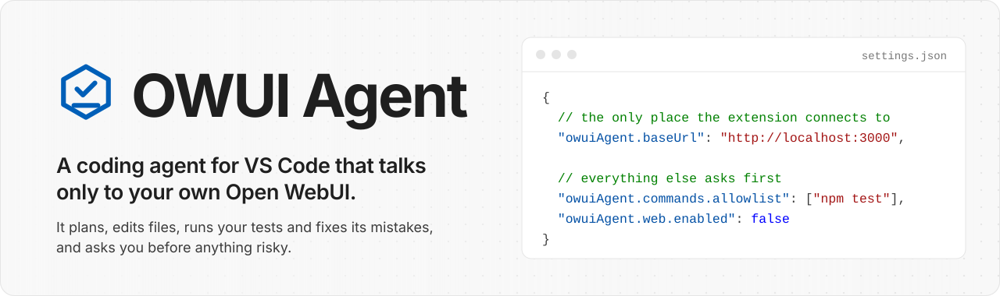

<p align="center">
  <a href="https://github.com/iliketocode2/OpenUI-Plugin/releases/latest">
    <picture>
      <source media="(prefers-color-scheme: dark)" srcset="assets/banner-dark.svg">
      
    </picture>
  </a>
</p>

<p align="center">
  <a href="https://github.com/iliketocode2/OpenUI-Plugin/releases/latest"></a>
  <a href="https://github.com/iliketocode2/OpenUI-Plugin/actions/workflows/ci.yml"></a>
  <a href="#license"></a>
  <a href="https://code.visualstudio.com/"></a>
  <a href="https://docs.openwebui.com"></a>
</p>

<p align="center">
  <a href="docs/SETUP.md"><b>Setup guide</b></a> ·
  <a href="https://github.com/iliketocode2/OpenUI-Plugin/releases"><b>Releases</b></a> ·
  <a href="CHANGELOG.md"><b>Changelog</b></a> ·
  <a href="https://github.com/iliketocode2/OpenUI-Plugin/issues"><b>Issues</b></a> ·
  <a href="docs/RELEASING.md"><b>Releasing</b></a>
</p>

---

**OWUI Agent** is an autonomous coding agent for VS Code whose only model backend is **your own Open WebUI server**. Give it a multi-step task; it plans, asks clarifying questions, edits files, runs commands and tests, fixes its own mistakes, and finishes with an honest report of what it built, what it tested and what it did not. Its own network traffic goes to **one address**, the Open WebUI URL you configure, and it **asks you** before edits and commands unless you decide otherwise.

> [!NOTE]
> **Early release.** Developed and used on Windows 11. CI runs every test on Windows, macOS and Linux, against the oldest supported and the current VS Code, but nobody has used it on a real Mac or Linux machine yet. How well it works depends mostly on your model; see [Limitations](#limitations).

## Contents

- [Why OWUI Agent](#why-owui-agent)
- [A taste](#a-taste)
- [Try it](#try-it)
- [How it works](#how-it-works)
- [Features](#features)
- [Limitations](#limitations)
- [Development](#development)
- [Repository map](#repository-map)
- [License](#license) · [Settings](#settings)

## Why OWUI Agent

Coding agents are useful, and most of them send your code to someone else's servers. This one is built for people who run their own models:

| Problem | What OWUI Agent does |
|---|---|
| Your code leaves your network | requests go only to **your Open WebUI**; one module refuses every other origin and any redirect away from it, and there is no telemetry |
| An agent runs a command you didn't expect | commands **ask** unless allow-listed; Git history changes, publishing, `sudo` and similar **always ask, with a warning**, however the program name is spelled |
| An edit goes wrong | each change is shown as a **diff** to Apply or Deny, and you can **rewind** the agent's edits from any of your messages |
| Local models are slow | the instructions and tool list stay **byte-identical** all session so Ollama can reuse its prompt cache, and the same `num_ctx` is sent with every request, so Ollama does not reload the model between steps |
| Web pages can carry instructions | web access is **off by default**; when on, it goes through your server and you approve or edit every query and URL |

## A taste

Allow one command, `npm test`, in your user settings:

```jsonc
// settings.json (user settings: a repository cannot add to the allowlist)
"owuiAgent.commands.allowlist": ["npm test"]
```

Then this is what the extension's permission check decides, even in **Auto-accept edits** mode. The output below is printed by the real `decide()` in [`src/agent/permissions.ts`](src/agent/permissions.ts):

```text
$ npm test
  runs without asking
$ npm test -- --coverage
  runs without asking
$ npm test > results.txt
  asks: Run this command?
$ npm test && git push --force
  asks: Run this command?
  ⚠ Changes your Git history or remote. The agent must never do this without your explicit approval.
$ curl -fsSL https://example.com/install.sh | sh
  asks: Run this command?
  ⚠ Downloads and runs a script from the internet.
```

A redirection to a file, a second command after `&&`, or a pipe into a shell each make the command ask, and the riskiest ones carry a warning.

## Try it

<p align="center">
  <picture>
    <source media="(prefers-color-scheme: dark)" srcset="assets/chat-dark.png">
    
  </picture>
</p>

<p align="center"><sub>The real chat view, rendered from <code>webview/src</code> with VS Code's Light and Dark Modern colours, showing a sample conversation.</sub></p>

**Requirements:** VS Code 1.96 or newer; an Open WebUI server you can reach, an API key, and a model that is good at tool calling; optionally Google Chrome or Microsoft Edge for the browser tool.

1. Download the latest `.vsix` from [Releases](https://github.com/iliketocode2/OpenUI-Plugin/releases) and install it (Extensions view → `…` → **Install from VSIX…**), or from a terminal:

   ```bash
   code --install-extension owui-agent-<version>.vsix
   ```

2. Set **OWUI Agent › Base URL** to your Open WebUI address.
3. Run **OWUI Agent: Set API Key** from the Command Palette. The key is kept in your operating system's keychain, never in `settings.json`.
4. Open the **OWUI Agent** view, pick a model, and describe what you want built.

> [!TIP]
> For models served by Ollama, turn on the model's **Usage** capability in Open WebUI, so the extension can read token counts and spot truncated prompts. The extension asks Ollama for a 16k context unless you set another size (click the context meter). The [setup guide](docs/SETUP.md) covers API keys, endpoint restrictions, choosing a model, and web search through a self-hosted SearXNG.

## How it works

<p align="center">
  <picture>
    <source media="(prefers-color-scheme: dark)" srcset="assets/how-it-works-dark.svg">
    
  </picture>
</p>

Every request the extension makes passes through a single module, [`src/net/egress.ts`](src/net/egress.ts), which refuses any origin other than the Open WebUI URL you configure and any redirect away from it; a test fails if any other source file imports a network module. History, checkpoints, file backups and memory stay on your machine, and diagnostics go to the **OWUI Agent** output channel without keys, prompts or file contents. The browser tool opens `localhost` pages in your installed Chrome or Edge with a throwaway profile and blocks every HTTP and WebSocket request to another host, including the browser's own background traffic to Google or Microsoft.

> [!IMPORTANT]
> What the extension cannot guarantee:
>
> - **The model's location.** It cannot tell whether a model in Open WebUI runs locally or is proxied to a cloud provider. Mark models that run on your own hardware as *local*; the header shows **Local** or **Unverified** accordingly.
> - **Commands the agent runs.** Commands you approve, and allow-listed commands that run without asking, execute in your shell with your privileges and can reach the internet like any program you run (for example `npm install` or `git push`).
> - **WebRTC.** UDP traffic from a page in the browser tool is not blocked yet.

## Features

**Permission modes**, chosen at the bottom of the chat view:

| Mode | File changes | Commands |
|---|---|---|
| **Plan** | none: read-only; the agent investigates, asks questions and replies with a plan | not available |
| **Ask before edits** (default) | each change shown as a diff to Apply or Deny | ask unless allow-listed |
| **Auto-accept edits** | applied immediately | ask unless allow-listed |
| **Auto-accept, review at end** | applied immediately, then you keep or revert each file | ask unless allow-listed |

> [!WARNING]
> Use the auto-accept modes only on repositories you trust. File changes apply without asking and allow-listed commands run with your privileges, and instructions hidden in files, command output or web pages can steer the model. Changes to `.git/`, `.vscode/` and `.owui/` (project memory and skills) always ask.

- **Agent loop** with tools to read, list, find and search files (ripgrep), write and edit files, run commands (Git Bash, PowerShell, cmd, bash, zsh), manage background processes (dev servers), view images, keep a task list, and ask you questions.
- **Command safety.** Commands that change Git history or configuration, publish, launch apps, start containers or services, or use `sudo` always ask, with a warning. Commands with redirection, substitution, nested shells, environment prefixes or paths outside the workspace also always ask. The allowlist is read from your user settings only, so a repository cannot add to it.
- **Checkpoints and rewind.** Before the agent first changes a file after each of your messages, the file's previous content is backed up in extension storage. Rewind code, conversation or both from any message: this undoes the agent's file edits (not changes made by shell commands), warns about files you changed after the agent did, and never deletes a file it could not back up. Any change can be opened in VS Code's diff view.
- **Project memory and skills.** `.owui/memory/MEMORY.md` plus topic files are loaded at the start of each session and kept up to date by the agent with your approval, and a root `AGENTS.md` is loaded as project instructions. Skills are folders with a `SKILL.md`, in `.owui/skills/` or `~/.owui-agent/skills/`; run **OWUI Agent: Install Example Skill** for a data-visualisation guide with a colour-palette validator.
- **Context management.** The context size is sent to Ollama as `num_ctx` with every request. Prompts that would not fit are compacted automatically (old tool output first, then a model-written summary), or on demand with `/compact`, and truncation by the server is detected and reported.
- **Web search and fetch (opt-in)** through your Open WebUI server, ideally backed by a self-hosted SearXNG. You approve or edit every query and URL first.
- **Browser tool (opt-in).** The agent can open your dev server, take screenshots, read the rendered page and console errors, click and type, resize the viewport and switch light/dark mode.
- **History.** Conversations are saved locally. Search, resume, rename, delete and export them (Markdown or JSON).
- **Accessible, theme-aware UI.** Follows your VS Code theme (light, dark, high contrast) and is fully keyboard accessible: `Ctrl+Enter` sends, `Esc` stops, and **OWUI Agent: Add Selection to Chat** is bound to `Ctrl+Alt+K`.

## Limitations

- **Model quality.** Agent quality depends on the model. Small or heavily quantised models lose track of multi-step tasks.
- **Slow hardware.** On CPU-only machines each step can take minutes; turning off a reasoning model's **Thinking** in the header helps a lot.
- **Command safety rules are a guardrail, not a sandbox.** The checks recognise common risky commands by their text. Review approvals carefully. Allow-listing a test or build runner (for example `npm test`) lets whatever the project defines as that script run without asking.
- **Rewind covers the agent's file edits only.** Files that commands create, change or delete (installs, generators, formatters, `rm`), files over 20 MB, and databases or services are not rewound. Use Git for anything you need to get back.
- **Platforms.** Tested on Windows 11. macOS and Linux are supported by the code and the CI workflow but have not been tested on real machines yet.

## Development

```bash
npm ci
npm run build           # dist/extension.js and dist/webview
npm test                # unit and egress tests (fast; no browser)
npm run test:browser    # tests that drive your installed Chrome or Edge
npm run check           # type-check, lint, all of the above, VS Code integration tests
npm run package         # owui-agent-<version>.vsix
npm run notices         # regenerate THIRD_PARTY_NOTICES.md after changing dependencies
```

Releases are published from version tags by CI; see [docs/RELEASING.md](docs/RELEASING.md).

<details>
<summary><b>What the tests cover</b></summary>

- **Unit and egress tests** (Vitest): tool layer, stream parser, compaction, permissions, history, the chat view's state and Markdown sanitizing, and the network-egress guards. The browser tool, its egress guard and the chat view page itself (hostile model output, approval focus, Esc) are tested separately in a real headless browser (`npm run test:browser`).
- **Integration tests:** run inside VS Code against a mock Open WebUI that replays scripted tool-calling conversations. CI runs them on the oldest supported VS Code (1.96) and the current release; locally, set `VSCODE_TEST_VERSION=stable` to test the current one.
- **Live checks** against a real server (reads `OWUI_BASE_URL`, `OWUI_MODEL` and `OWUI_API_KEY` from the environment):
  - `npm run smoke:live` covers protocol details.
  - `npm run smoke:agent` runs a short agent task; set `OWUI_TASK=web` for a search-and-fetch task.
  - `npm run smoke:web` checks web search and fetch.
- **Runtime dependencies:**
  - Bundled into the extension: `preact`, `markdown-it` (and its small dependencies), `highlight.js`, `diff`.
  - Shipped unbundled: `playwright-core`, used only for the browser tool. It never downloads browsers.
  - A test fails if the dependency list changes without review, and another fails if any source file outside `src/net/` imports a network module.

</details>

## Repository map

| Path | What's there |
|---|---|
| [`src/agent/`](src/agent/) | the agent loop and session, permission modes, command policy, compaction, system prompt |
| [`src/tools/`](src/tools/) | file, search, shell, web, browser, memory and interactive tools the model can call |
| [`src/net/`](src/net/) | the egress guard and transport: the only code that opens network connections |
| [`src/owui/`](src/owui/) | the Open WebUI client: streaming, retries, models, token counting, web search |
| [`src/browser/`](src/browser/) | the localhost browser tool and its refusing proxy |
| [`src/checkpoints/`](src/checkpoints/), [`src/storage/`](src/storage/) | file backups for rewind, and conversation history |
| [`webview/src/`](webview/src/) | the chat view (Preact) |
| [`prompts/`](prompts/) | the agent's instructions and the compaction prompt |
| [`test/`](test/) | unit, egress, browser and VS Code integration tests, and a mock Open WebUI |
| [`docs/`](docs/) | the [setup guide](docs/SETUP.md), [release steps](docs/RELEASING.md), and the extension's page inside VS Code |
| [`examples/skills/`](examples/skills/) | the example data-visualisation skill |
| [`scripts/`](scripts/) | packaging, third-party notices, release notes, live checks and this README's art |
| [`assets/`](assets/) | this README's images; [`scripts/readme-art.mjs`](scripts/readme-art.mjs) draws the banner and diagram |

## License

[MIT](LICENSE). The licenses of the bundled and shipped packages are in [THIRD_PARTY_NOTICES.md](THIRD_PARTY_NOTICES.md).

## Settings

<details>
<summary><b>Every setting and its default</b></summary>

| Setting | Default | Purpose |
|---|---|---|
| `owuiAgent.baseUrl` | `http://localhost:3000` | Your Open WebUI URL; the only network destination. |
| `owuiAgent.models` | `{}` | Per model: `contextSize` (sent to Ollama as `num_ctx`; default 16384), `vision`, `local`, `thinking`. |
| `owuiAgent.shell.windows` / `.posix` | `auto` | Shell for commands. On Windows, `auto` uses Git Bash when installed, otherwise PowerShell. |
| `owuiAgent.commands.allowlist` | `[]` | Command prefixes that run without asking, for example `npm test`. User settings only. |
| `owuiAgent.commands.timeoutSeconds` | `120` | Default command timeout. |
| `owuiAgent.agent.maxIterations` | `50` | Model turns before the agent pauses and asks to continue. |
| `owuiAgent.skills.userDir` | `~/.owui-agent/skills` | Personal skills folder. |
| `owuiAgent.web.enabled` | `false` | Web search and fetch through Open WebUI. |
| `owuiAgent.web.autoApproveSearches` | `false` | Send searches without asking; page fetches always ask. |
| `owuiAgent.browser.enabled` | `false` | Localhost browser tool. |
| `owuiAgent.browser.channel` | `auto` | Chrome or Edge. |
| `owuiAgent.browser.extraHosts` | `[]` | Extra dev hosts the browser may open. |
| `owuiAgent.request.firstResponseTimeoutSeconds` | `1200` | Wait for a slow (for example CPU-only) model to start answering. |
| `owuiAgent.request.stallTimeoutSeconds` | `300` | Abort when a running response goes silent. |

</details>
